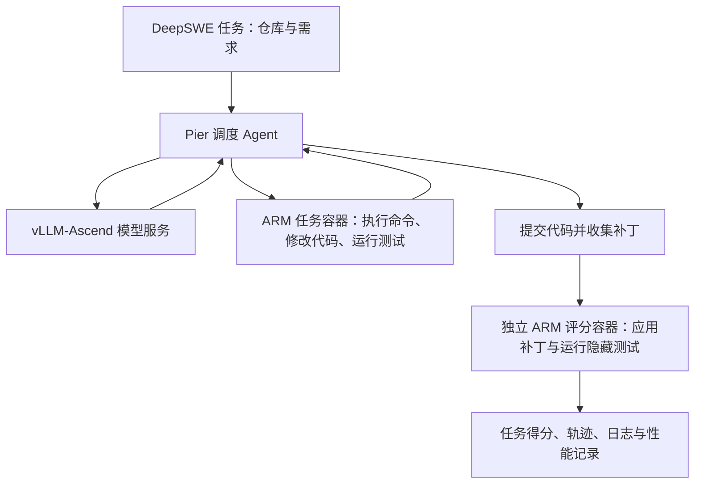

# 00：项目概览与环境基线

- 创建日期：2026-11-12。
- 时区：Asia/Shanghai（UTC+8）。
- 工作目录：`/home/zhaozihan/vLLM`。
- 当前阶段：已验证首批 ARM 任务执行与评分环境，准备部署模型并接入真实 Agent。
- 本文性质：项目起步基线；“已完成”和“待完成”以本文记录时的证据为准。
- [返回文档索引](README.md)。
- 持续更新的参考：[当前环境](../ENVIRONMENT.md)、[助手协作约定](../AGENTS.md)。本文保留项目起步时的基线快照。

## 1. 为什么做这个项目

导师建议以流程较复杂的软件工程 Agent 评测为入口，学习模型推理服务与算法效果验证。现有资源是一台配备八张 Ascend 910B1 的 ARM 服务器，计划使用 vLLM-Ascend 完成模型部署和推理实验。

学习基础：已有 Python、Linux、PyTorch 和 Transformer 的基本了解，采用“先跑通完整流程，再结合问题深入原理与源码”的方式推进。

项目围绕三个目标展开：

1. **工程目标**：建立可复现的本地模型服务、Agent 执行和 DeepSWE 评分流程。
2. **学习目标**：理解模型生成、推理调度、内存与缓存、多卡通信，以及这些机制在长程 Agent 工作负载中的表现。
3. **研究目标**：固定基线后，逐项尝试推理优化，用任务成功率、性能和资源指标判断收益与代价。

具体优化算法尚未选定。长期可以尝试量化、缓存优化、推测解码、并行和调度，但每项正式实验需要明确问题、控制变量和验证标准。

## 2. 本项目中的概念与系统分工

### 2.1 评测对象已经明确

本项目使用的是 **Datacurve 的 DeepSWE**，当前源码含 113 个任务，覆盖 Python、Go、TypeScript、JavaScript 和 Rust。

它与 Agentica 的 `DeepSWE-Preview` 模型是不同项目。本项目不以复现该模型的 SWE-bench Verified 分数为目标，也不包含模型训练或强化学习训练。

### 2.2 各部分分别负责什么

| 部分 | 项目中的选择 | 职责 |
| --- | --- | --- |
| 硬件 | Ascend 910B1 × 8 | 执行模型计算 |
| 模型 | 计划采用 Qwen3.8-27B BF16 | 根据输入生成文本或工具动作；仍需下载、固定版本和验证 |
| 推理框架 | vLLM + vLLM-Ascend | 加载模型，执行计算，管理缓存、调度和多卡通信，提供服务接口 |
| Agent | 计划优先接入 mini-swe-agent | 组织提示词，调用模型，在任务环境中执行工具并反馈结果 |
| 评测工具 | Pier 0.3.1 | 调度任务、管理环境、收集提交、运行独立评分、保存轨迹和结果 |
| 任务与验证器 | Datacurve DeepSWE | 提供初始仓库、需求、隐藏测试与评分规则 |
| 隔离环境 | ARM64 Docker 容器 | 运行代码与测试，并隔离 Agent 和评分环境 |

vLLM 是推理引擎，仍需要加载模型权重。选择 vLLM 并不等于已经选择模型。

### 2.3 计划中的端到端流程



当前所有环节均计划在同一台服务器上运行。任务执行和评分主要消耗 CPU、内存及磁盘，模型推理使用 NPU。已放弃依赖外部 x86/WSL 执行端作为主部署路线，转为本机 ARM 原生适配。

## 3. 服务器与存储环境

以下为 2026-11-12 的检查快照。可用内存、空闲磁盘和卡上占用会随其他任务变化，正式实验前需要重新检查。

| 项目 | 已检查到的配置 |
| --- | --- |
| 操作系统 | Huawei Cloud EulerOS 2.0 |
| CPU 架构 | aarch64 / ARM64 |
| CPU | Kunpeng 920，192 个逻辑 CPU，8 个 NUMA 节点 |
| 主机内存 | 约 1.5 TiB；本文整理时可用约 1.1 TiB |
| 主机 Swap | 未配置 |
| NPU | 8 × Ascend 910B1，每卡 64 GiB HBM，合计 512 GiB |
| 初次 NPU 状态 | 八卡健康状态正常，未发现运行中的 NPU 进程；每卡约 3.4 GiB 已占用 |
| npu-smi 报告版本 | 25.5.0；不能仅据此替代驱动、固件和 CANN 的完整版本记录 |
| 工作区磁盘 | `/home/zhaozihan/vLLM` 位于约 7 TiB 的磁盘，剩余约 691 GiB |
| Docker 数据盘 | `/var/lib/docker` 位于独立约 14 TiB 的磁盘，剩余约 12 TiB，使用 overlay2 |

两块数据盘应分别管理：模型下载、文档和实验结果会占工作区空间，镜像层和构建缓存主要占 Docker 数据盘空间。后续不采用全局 Docker 清理方式，以免影响其他项目。

## 4. 软件环境与版本边界

### 4.1 已安装、已验证的评测工具

| 组件 | 版本或位置 | 验证情况 |
| --- | --- | --- |
| 系统默认 Python | 3.9.9 | 版本低于当前 Pier 要求，未替换 |
| 项目独立 Python | 3.12.15，位于 `.runtime/python/` | 已创建并使用 |
| Pier 虚拟环境 | `pier/.venv/` | 按上游 `uv.lock` 安装，CLI 可运行 |
| Pier | 0.3.1 | 已完成任务调度与独立评分实测 |
| 系统 Docker Engine | 18.09.0，API 1.39 | 沿用既有服务，未替换或重启 |
| 项目 Docker CLI | 27.5.1，`.runtime/bin/docker` | 已验证自动协商到旧服务端 API |
| 项目 Docker Compose | 2.32.4，位于项目 Docker 配置目录 | 已核对官方 SHA256；启动等待、执行和资源限制检查通过 |
| 环境包装器 | `scripts/with_arm_env.sh` | 为单个命令设置工具路径、Docker 配置和本地模型费用表选项，禁用 BuildKit |

包装器使用独立的 `.runtime/docker-config/`。当前工具链可以支持已实测的工作负载，但不能据此假定所有新 Docker 功能都兼容 Engine 18.09。

### 4.2 源码与基础镜像固定信息

| 对象 | 固定版本 |
| --- | --- |
| DeepSWE | `0b9fabbb63b9104d678fe965e1632f2dd9eaa2ea` |
| Pier | `b26211ed2bbee6d145f6b8c5b80e39f18b296f08`，另有本地权限适配补丁 |
| ARM 基础镜像 | `public.ecr.aws/x8v8d7g8/mars-base@sha256:8d4d973c993776850e6249f909431040f0f0e694162768b1ed1409ba64162cb2` |

基础镜像中的工具版本为 Python 3.12.12、Go 1.25.5、Node 24.12.0、Cargo 1.92.0，与宿主机工具版本分别记录。

### 4.3 推理环境尚待固定

- 服务器存在多个 vLLM-Ascend 镜像，包括 `v0.30.0`、若干候选版和其他版本。已有镜像存在及 ARM 容器可启动，不等于目标模型已完成 NPU 推理验证。
- 已看到多个 CANN 安装目录，包括 `cann-8.5.0`、`cann-9.2.0-beta.1` 等；目录存在不代表本项目正在使用该版本。
- 模型部署阶段需要固定完整组合：驱动、固件、容器内 CANN、PyTorch、torch-npu、vLLM、vLLM-Ascend、模型权重 revision 和启动参数。
- 尚未部署本项目的模型服务，尚未完成真实模型 Agent 的安装、接口和网络联调。

## 5. 已完成的项目准备

### 5.1 发现并处理 ARM 兼容问题

对全部官方镜像逐一查询后确认：113 个任务镜像均只有 `linux/amd64` 版本；共用基础镜像同时有 `linux/amd64` 和 `linux/arm64` 版本。

全部任务采用独立评分容器，其 `tests/Dockerfile` 也引用对应 amd64 任务镜像。因此本机适配需要同步处理 Agent 任务镜像与评分镜像，不能仅修改一个基础镜像地址。

已在 `arm/tasks/` 生成 113 个独立配置副本，并通过 Pier 的任务格式解析。原始 `deep-swe/` 仓库保持未修改。副本中的提示词、参考解答、隐藏测试、评分器和评分配置已与上游逐文件校验 SHA256。

### 5.2 已处理的具体问题

| 问题 | 处理方式 | 当前边界 |
| --- | --- | --- |
| 默认 Python 不满足要求 | 建立项目内 Python 3.12 与 Pier 虚拟环境 | 评测工具已可运行 |
| 系统缺少 Compose、客户端较旧 | 在项目内安装 CLI 和 Compose，沿用既有 Engine | 代表任务已验证 |
| 构建容器拉取代码失败 | 构建阶段使用 host 网络并继承 HTTP(S) 代理 | 正式任务与评分继续保留隔离；模型 API 网络尚待联调 |
| Deno 下载地址写死 x86 | 改用相同版本的 aarch64 地址 | 对应任务尚未构建和实测 |
| Rust nextest 下载入口默认 x86 | 五个 Rust 任务改用 `/linux-arm`，保持 0.9.97 | 已在 Pest 任务验证工具可运行 |
| Pest 引导工具解析到不兼容新版本 | 在构建阶段将外部 pest 系列依赖固定到 2.8.6 | Pest 正负对照均通过；属于依赖兼容修复 |
| 评分文件权限导致宿主用户无法读取 | Pier 的 Linux 命令包装设置 `umask 022` | 重跑成功；相关上游生命周期测试 15 项通过 |

权限补丁保存在 [pier-readable-artifacts.patch](../arm/patches/pier-readable-artifacts.patch)。这些适配没有修改评分逻辑，但 ARM 重建及依赖变化仍须作为环境差异记录。

### 5.3 实测覆盖范围

`oracle` 执行官方参考解答；`nop` 不修改代码。F2P 表示任务新增能力相关测试，P2P 表示应继续通过的原有回归测试。

| 语言 | 任务 | oracle F2P | oracle P2P | nop F2P | nop P2P |
| --- | --- | --- | --- | --- | --- |
| Python | httpx-multipart-response-parsing | 122/122 | 1272/1272 | 0/122 | 1272/1272 |
| Go | tengo-callable-instance-isolation | 23/23 | 122/122 | 0/23 | 122/122 |
| JavaScript | yjs-map-conflict-detection | 9/9 | 231/231 | 0/9 | 231/231 |
| TypeScript | ts-pattern-match-each | 85/85 | 6/6 | 0/85 | 6/6 |
| Rust | pest-character-class-coalescing | 104/104 | 250/250 | 0/104 | 250/250 |

五个任务的十次最终对照均得到预期结果：oracle 的 reward 为 1，nop 的 reward 为 0，且没有评测工具异常。完整历史共 11 次，包含修复前 Go 的一次权限错误，未删除该失败记录。

**目前仅有 5/113 个任务完成构建与正负对照，剩余 108 个尚未验证。上述结果证明首批环境链路可用，不是模型成功率，也不能证明全部 ARM 环境与官方 amd64 环境等价。**

证据：[验证汇总](../arm/validation.json)、[原始实验目录](../arm/jobs/)、[配置准备清单](../arm/manifests/all-tasks.json)。

## 6. 模型选择与初始实验方案

### 6.1 当前选型决定

主实验模型选择 **`Qwen/Qwen3.8-27B` 的 BF16 原始权重**。Qwen3.6-27B BF16 作为兼容性备用，只有出现明确部署障碍并记录原因后再考虑切换。

选择依据：

1. 发布方模型卡提供了 Datacurve DeepSWE 1.1 的直接评测证据：Qwen3.8-27B 为 42.2%，同表中的 Qwen3.6-27B 为 13.3%。该实验使用 Claude Code、256K 上下文、temperature=1.0、top_p=0.95，属于发布方自测，与本项目计划采用的 mini-swe-agent 不同，分数仅作选型参考。
2. vLLM-Ascend v0.30.0 官方教程列出 A2、8×64 GB 的 BF16 部署路线，与当前服务器资源规格对应；仍需本机实测。教程也注明性能调优尚未充分验证。
3. 27B 规模便于反复实验。按每参数 2 字节粗算，权重约 54 GB，实际运行还需要其他内存开销。

目前只完成选型讨论，**尚未下载并锁定权重 revision，也没有本机部署或模型评测结果**。

### 6.2 学习与算法适用范围

模型采用 Gated DeltaNet 与 Attention 混合结构，并含 MTP 设计。它适合研究真实 Agent 工作负载、混合状态管理、量化、通信和后续推测解码，但具体功能仍要核对所用版本与本机支持情况。

传统 Transformer 的 KV Cache 优化不能直接应用到所有 DeltaNet 状态。后续若研究特定缓存算法或 MoE，需要根据研究问题补充相应架构的模型；不要求一个模型覆盖所有推理知识。

### 6.3 起步配置原则

- 先使用 BF16 原始权重建立对照，再逐项加入优化。
- 先用短请求和少量任务检查服务与 Agent 行为，再增加上下文、并发和任务数。
- 调试阶段的短上下文配置不作为官方长上下文结果的直接复现依据。
- 张量并行度、服务并发、上下文上限、采样、工具格式、Agent 版本、超时和重试规则均待部署阶段实测固定，当前不虚构一套“已验证参数”。

## 7. 怎样定义基线与验收

### 7.1 两类基线

| 基线 | 用途 | 比较条件 |
| --- | --- | --- |
| 官方或模型发布方公开结果 | 了解能力范围、检查复现差异 | 需说明模型、任务版本、Agent、上下文与预算差异 |
| 本机原始推理配置 | 判断自研优化的影响 | 同一权重、任务、Agent 和实验预算，明确改动变量 |

优化前后比较以第二类基线为主要依据。仅把公开 GPU 分数与本机优化后的 NPU 分数相减，无法区分硬件、框架、Agent 和算法各自的影响。

### 7.2 需要记录的指标

| 层次 | 指标或证据 |
| --- | --- |
| 环境正确性 | oracle/nop、测试是否实际执行、评分容器隔离、异常与原始日志 |
| 模型数值行为 | 按算法需要检查固定输入下的 logits、概率或输出异常；具体方法待定 |
| 任务效果 | resolved rate / reward、成功与失败样本的配对变化、轨迹与失败原因 |
| 模型服务性能 | 首 token 延迟、后续 token 延迟、吞吐、请求长度、并发、HBM 峰值 |
| Agent 端到端成本 | 每题耗时、轮数、token 用量、工具执行时间与重试次数 |

“环境跑通”“数值接近”“任务效果没有可检测下降”是不同结论。正式实验前需要确定任务范围、重复次数、允许的效果下降幅度以及统计判断方式；当前尚未设定“无损”阈值。

评测应区分模型未完成任务、工具格式错误、服务超时、内存不足和容器构建失败。基础设施错误的重试、计分与报告方式要事先固定，不事后选择性排除。

### 7.3 分阶段验收

| 阶段 | 通过条件 | 当前状态 |
| --- | --- | --- |
| A：代表任务 ARM 环境 | 五种语言各一个任务的正负对照符合预期 | 已完成 |
| B：模型服务 | 固定软件与权重版本，短/长/多轮请求可运行并保存启动配置 | 待完成 |
| C：真实 Agent 闭环 | Agent 调用本地模型、执行工具、提交补丁、由独立容器评分 | 待完成 |
| D：正式基线 | 固定任务范围、参数与失败处理规则，完成相应覆盖和重复实验 | 待完成 |
| E：优化对照 | 至少完成一项明确优化，报告效果、性能、资源收益及结论边界 | 待完成 |

浏览器、数据库及其他复杂依赖任务需继续适配。只使用部分任务时，明确报告子集及选择方式，不将子集成功率写成全量 DeepSWE 成功率。

## 8. 工作区导航与已有命令

| 路径（相对工作目录） | 用途 |
| --- | --- |
| `docs/` | 按编号维护的研究与学习记录 |
| `deep-swe/` | 固定提交的上游任务源码 |
| `pier/` | 评测工具源码和项目虚拟环境 |
| `.runtime/` | 独立 Python、工具、下载缓存和 Docker 客户端配置 |
| `arm/tasks/` | 本机 ARM 配置副本 |
| `arm/manifests/` | 来源与文件校验清单 |
| `arm/build-logs/` | 镜像构建日志，同任务重建可能覆盖 |
| `arm/jobs/` | 按次保存的任务配置、轨迹、评分和异常 |
| `arm/validation.json` | 正负对照结果汇总，包含历史失败 |
| `scripts/` | 配置生成、环境包装、构建、冒烟验证和汇总入口 |

已有复现命令：

```bash
cd /home/zhaozihan/vLLM

# 查看项目内工具版本。
scripts/with_arm_env.sh pier --version
scripts/with_arm_env.sh docker compose version

# 重建并验证一个任务；需要当前用户能访问 Docker 服务。
scripts/build_arm_task.sh httpx-multipart-response-parsing
scripts/smoke_arm_task.sh httpx-multipart-response-parsing oracle
scripts/smoke_arm_task.sh httpx-multipart-response-parsing nop

# 汇总实际运行记录。
python3 scripts/summarize_arm_checks.py
```

上述命令是操作入口，重新运行会产生构建或新的实验记录。后续新实验文档需保存具体命令、参数和对应 job 路径，并在重建前归档需要保留的构建日志。

## 9. 下一阶段需要完成的任务

1. 固定推理软件栈，确认容器内组件与宿主驱动兼容。
2. 下载并固定 Qwen3.8-27B BF16 权重版本，建立短请求推理检查。
3. 验证长上下文、缓存状态和多卡运行，保存服务启动配置。
4. 安装并接入 mini-swe-agent，验证工具动作、费用/上下文配置以及模型接口网络可达性。
5. 在已验证的任务上完成真实模型闭环，分清环境错误与模型失败。
6. 扩大 ARM 任务覆盖，建立正式基线，再选择第一项推理优化。

执行过程中按实际顺序创建 01、02 等研究文档，并同步更新 [索引](README.md)。

## 10. 外部资料与本地证据

- [Datacurve DeepSWE 官方仓库](https://github.com/datacurve-ai/deep-swe)：任务、评分格式和官方执行方式。
- [Pier 官方仓库](https://github.com/datacurve-ai/pier)：评测工具、Agent 与容器环境。
- [Qwen3.8-27B 官方模型卡](https://huggingface.co/Qwen/Qwen3.8-27B)：结构、公开自测结果及其评测配置。
- [Qwen3.8-27B 的 vLLM-Ascend v0.30.0 教程](https://docs.vllm.ai/projects/ascend/en/v0.30.0/tutorials/models/Qwen3.8-27B.html)：A2 部署路线及当前调优限制。
- [vLLM-Ascend 支持矩阵](https://docs.vllm.ai/projects/ascend/en/main/user_guide/support_matrix/supported_models.html)：动态资料，正式部署时应对照固定版本复核。
- [cargo-nextest 架构下载说明](https://nexte.st/docs/installation/pre-built-binaries/)：ARM 下载入口。
- [本机 ARM 操作说明](../arm/README.md)、[验证结果](../arm/validation.json)、[镜像架构元数据](../deepswe-image-platforms.json)。

外部资料在本次选型讨论中于 2026-11-12 查阅。模型卡分数属于发布方报告；本地实验结论以实际保存的任务结果为依据。

## 11. 变更记录

| 日期 | 内容 |
| --- | --- |
| 2026-11-12 | 建立 00 号基线文档与文档索引；确认本机 ARM 路线、Qwen3.8-27B BF16 主选型，以及五个代表任务的环境验证结果。 |
